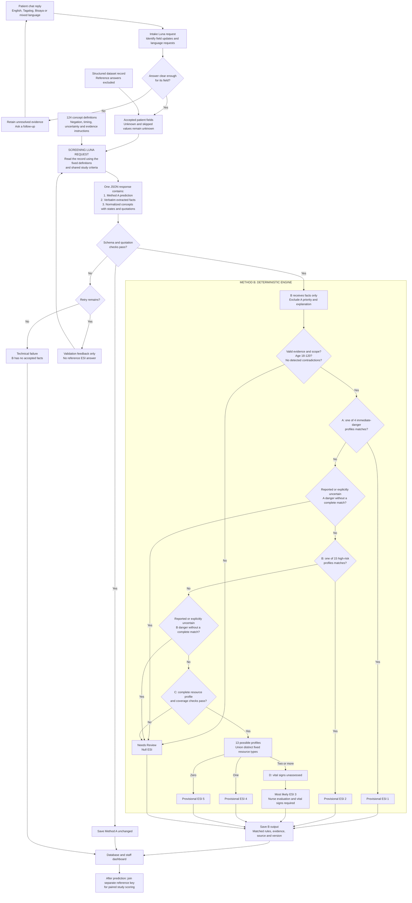

# FirstLook: complete symptom interpretation and rule decision path

Implementation inspected on 21 October 2026. Active mode: `research_prototype`.

## 1. How the symptom and risk definitions were chosen

The ESI v4 handbook supplied the decision sequence, examples of higher-acuity presentations and the resource framework. The patient fields and DEV presentations determined which reported meanings the prototype needed to represent. Those meanings were written as a controlled vocabulary; explicit combinations of those meanings were written as deterministic profiles. The vocabulary and combinations are research-authored implementation choices, not an automatically learned clinical model or a verbatim reproduction of every handbook criterion.

The handbook discusses clinical judgment, expected resources and assessment including vital signs. Our patient-report-only mappings and provisional ESI 3 are adaptations. A source citation does not establish validation of the exact software condition. [ESI v4 implementation handbook, official government copy](https://www.govinfo.gov/content/pkg/GOVPUB-HE20_6500-PURL-gpo23161/pdf/GOVPUB-HE20_6500-PURL-gpo23161.pdf).

The other studies provide design and evaluation context; they did not generate or independently validate our 70 profiles; the profiles cite the ESI v4 and v5 handbooks. Their specific support and limits are listed in [the sources guide](research-prototype-rules.md#verified-sources-and-their-actual-role).

There was no fine-tuning, training on the development labels, statistical discovery of thresholds, new symptom-severity model or automatic diagnosis. Reference labels were excluded from the 70 DEV prediction requests. DEV outcomes were subsequently compared with those labels locally, so these remain development findings rather than unseen-test estimates.

## 2. The three separate representations

| Representation | Example | Who creates it? |
|---|---|---|
| Patient statement | A statement in English, Tagalog, Bisaya or mixed language | Patient or structured dataset |
| Interpreted facts | `chest_discomfort = reported`, `sweating = reported`, with original quotations | Luna, under the fixed vocabulary instructions |
| Rule conclusion | A defined combination matches `RP-B-CHEST`, supporting provisional ESI 2 after earlier checks | Deterministic PHP engine |

Luna does not pass a `high_risk = true` field, a resource count, a diagnosis or a recommended ESI to Method B. Terms such as `severe_pain` and `new_confusion` are permitted only as interpretations of explicit reports; they are not measured severity or examination findings. An isolated numeric pain score does not establish `severe_pain`.

## 3. How the record reaches the screening model

### Interactive chatbot route

`IntakeInterpreter` reads the current reply, prior answers, unresolved fields and recent question context. It identifies patient-field updates and an optional language-change request. Its intake states include `unclear`, and `needs_detail` marks an incomplete answer. `ConversationalInterview` keeps unresolved evidence separately, asks follow-up questions and updates the accepted answer fields. A skipped/unknown answer remains unknown. The application also has a small set of language/placeholder and ambiguity checks; it is not accurate to say that there are no language-specific strings anywhere in the project. These checks do not implement the clinical risk profiles.

Once the visit is ready and submitted for screening, the accepted answer fields go to `ScreeningService`. The final patient-chat message currently presents Method A's result; both A and B are stored for staff inspection. Chat intake has its own model requests before the screening request.

### Structured dataset route

The DEV runner supplies the original 15 fields directly to `ScreeningService`. It does not simulate the question-and-answer interview. The saved structured-submission history therefore demonstrates what was submitted and predicted, not that the interactive interview collected those facts successfully.

Both routes restrict the screening patient record to the same 15 allowed fields. Case identifiers, split labels and expert answers are not added to the patient request.

## 4. What Luna receives and returns

The screening system prompt contains the research classification procedure, the shared rule criteria, extraction instructions, concept definitions and required output structure. It asks Luna to preserve negation, ambiguity, timing and original-language evidence and to ignore instructions embedded in patient text.

**One screening response returns all of these together:** Method A's status/priority/explanation, `extracted_facts`, `normalized_facts` and `missing_information`. These are separate JSON fields, not three isolated LLM calls. Luna is instructed to understand the facts before predicting. The architecture does not prove that its factual interpretation is unaffected by the classification instructions in that same request.

`extracted_facts` retain source field, state, value and verbatim evidence. `normalized_facts` use a standard concept identifier, state and one or more `{field, quote}` evidence anchors. The concept name is standardized; the quotation is not translated or corrected. Up to eight anchors are permitted per concept.

The same concept can represent equivalent meanings across languages. There is no per-language clinical mapping table and no exact-symptom-keyword requirement in the rule engine. This remains dependent on Luna's interpretation and is not a guarantee of perfect dialect or typo handling.

## 5. Fact states

| State | Meaning in the normalized record |
|---|---|
| `reported` | The patient/proxy reports it. This does not certify it as an observed clinical fact. |
| `absent` | An explicit denial supports absence. |
| `unknown` | Meaning or presence is uncertain. An evidence-backed uncertainty can block later rules. |
| `not_applicable` | Explicitly not applicable; kept distinct from absence. |
| `contradictory` | Incompatible reports about the same concept, with the conflicting quotations retained. |
| Missing concept | No entry was supplied. Internally tracked as missing, never automatically converted to absent. |

The prompt distinguishes whole-field dataset placeholders such as “Not reported” from “None reported.” The exact existing placeholder conventions are in `PatientFields`. It must not turn a general “no other symptoms” into individual denials of every unmentioned danger sign.

## 6. What the server verifies

`ScreeningOutput` and `NormalizedPatientFacts` check output keys/types, numerical-priority/status consistency, allowed fields/concepts/states, unique entries and evidence provenance. Extracted evidence must occur in its source field; normalized evidence must occur within the accepted extracted evidence. Known facts require supporting quotations. Tests and devices cannot supply normalized symptom evidence.

These checks can reject fabricated quotations or unsupported structure. **They cannot prove that the quoted sentence means the chosen concept, that negation was interpreted correctly, or that all relevant symptoms were extracted.** For example, a wrong concept attached to a real quotation can pass the quotation check. Semantic accuracy remains an evaluation question.

Invalid model output follows the bounded retry policy, with validation feedback but no expected ESI answer. Exhausted attempts produce a technical failure; Method B has an upstream failure because no accepted facts were available. This is different from a valid Needs Review result. An accepted Needs Review result is not retried to improve its ESI answer.

## 7. Method B's decision controls

1. Accept only the extracted and normalized facts and an empty clinical-assessment input. Method A's priority and explanation are excluded.
2. Require valid evidence, a reported adult age from 18 to 120, and no detected contradictions.
3. Evaluate A profiles first. Any matching A profile returns provisional 1. If none matches, a reported or explicitly uncertain listed A danger signal blocks progression with Needs Review. Evidence-backed uncertainty about breathing also blocks progression.
4. Evaluate B profiles. Any matching B profile returns provisional 2. If none matches, a reported or explicitly uncertain listed B danger signal blocks progression with Needs Review.
5. Evaluate C profiles and symptom-coverage checks. A matching profile cannot simply disregard additional supported symptoms from the coverage list. An unmapped symptom, unsupported head injury or relevant reported pregnancy can block resource classification. Worsening blocks a zero-resource-only result.
6. Union distinct resource types from the matching profiles. Zero predicts 5; one predicts 4; two or more predicts provisional 3. No profile means Needs Review. Completed/requested tests do not determine the count.
7. Record Decision D as unassessed. A predicted 3 displays “Most likely ESI 3” with the nurse-evaluation/vital-signs requirement. All numerical results remain provisional.

Within each profile, every `all` condition must match, and at least one alternative in **each** `any` group must match. A match at A takes precedence over B/C; a B match takes precedence over C. This is sequential matching, not a weighted symptom score.

**Research assumption:** an unmentioned danger sign stays missing/unassessed but does not itself stop a complete positive profile. Progressing beyond A or B does not certify that all clinical dangers were ruled out. This differs from completed clinical ESI assessment.

### Contradictions explicitly checked by the engine

In addition to any concept marked `contradictory`, the engine checks:

- Breathing without help reported, but breathing absent.
- Chest pressure reported, but chest discomfort absent.
- Lower-right abdominal pain reported, but abdominal pain absent.
- Worst-ever headache reported, but headache absent.
- Repeated vomiting reported, but vomiting absent.
- Current suicidal intent reported, but self-harm thoughts absent.
- Current unresponsiveness together with normal responsiveness or response to voice.
- Bleeding stopped together with uncontrolled bleeding.
- Symptoms improving together with worsening.

This finite list is not a complete semantic contradiction detector.

## 8. An actual saved DEV interpretation

In P102-V2, the Tagalog description included:

> Bigla kong naramdaman yung parang napupunit na sakit sa likod na umaabot sa tiyan ko.

The accepted output represented `sudden_onset`, `tearing_pain`, `back_pain` and `abdominal_pain` as reported, with quotations from the original fields. The saved evidence anchor includes the longer original description, not just the shortened sentence shown here. The full record also reported other symptoms and history.

The engine matched:

```text
RP-B-TEARING-PAIN
sudden_onset = reported
AND tearing_pain = reported
AND (back_pain OR abdominal_pain OR chest_discomfort) = reported
```

After its earlier checks, Method B saved provisional ESI 2. Method A independently returned Needs Review for this record and remained unchanged. No diagnosis was generated by the rule. The interpretation was read from a completed saved DEV output; no new API request was made to produce this example.

## 9. Complete architecture diagram

The diagram includes chatbot intake, the direct dataset route, symptom interpretation, output validation, the separate study outputs and all rule-engine decision stages. The appendices below enumerate the complete vocabulary and profile conditions.



## Appendix A. Complete normalized vocabulary

All **124** concept names and their exact definitions, exported from the active application. These are patient-report interpretations, including symptoms, history and context; not every concept independently triggers a rule.

| Concept | Definition given to Luna |
|---|---|
| `breathing` | Current breathing explicitly reported by the patient or proxy. |
| `breathing_without_help` | Explicitly breathing without assistance now; not inferred from typing. |
| `responds_to_voice` | Explicit current response to voice; not inferred from typing. |
| `responding_normally` | Explicit report of responding as usual; not an examination finding. |
| `uncontrolled_bleeding` | Reported current uncontrolled bleeding. |
| `chest_discomfort` | Reported chest pain, pressure or discomfort. |
| `chest_pressure` | Reported pressure sensation in the chest. |
| `pain_radiates_left_arm` | Reported pain spreading to the left arm. |
| `nausea` | Reported feeling of nausea. |
| `sweating` | Reported sweating associated with the complaint. |
| `onset_today` | Explicit onset today; do not calculate dates. |
| `sudden_onset` | Explicit abrupt onset, not merely recent onset. |
| `one_sided_weakness` | Reported weakness on one side. |
| `slurred_speech` | Reported slurred speech. |
| `headache` | Reported headache. |
| `worst_ever_headache` | Explicitly reported worst headache the person has experienced. |
| `previous_headaches` | Reported history of headaches; absent only when explicitly denied. |
| `throat_tightness` | Reported tightening of the throat. |
| `peanut_exposure` | Reported peanut exposure associated with this complaint. |
| `peanut_allergy` | Known peanut allergy explicitly reported as history. |
| `fever` | Subjective reported fever or feeling feverish, never measured temperature. |
| `current_chemotherapy` | Explicit report of currently receiving chemotherapy. |
| `cancer_history` | Cancer explicitly reported as known history; never inferred from symptoms. |
| `used_needle_puncture` | Reported puncture by a needle just used on another person. |
| `onset_just_now` | Explicitly just happened, without inventing a time threshold. |
| `excess_medication_ingestion` | Explicit report of taking more than prescribed; no dose calculation. |
| `new_confusion` | Reported confusion explicitly described as new. |
| `change_from_mental_baseline` | Explicit reported change from the usual mental baseline. |
| `current_suicidal_intent` | Explicit current suicidal intent, not a past event or hypothetical mention. |
| `self_harm_thoughts` | Reported current self-harm thoughts. |
| `severe_pain` | Explicitly described severe pain; a numeric score alone does not establish this concept. |
| `cancer_related_pain` | Patient explicitly attributes current pain to known cancer; not model attribution. |
| `unable_to_get_comfortable` | Explicit report of being unable to get comfortable. |
| `right_lower_abdominal_pain` | Reported pain specifically in the lower right abdomen; unspecified stomach pain is insufficient. |
| `loss_of_appetite` | Reported reduced or absent appetite. |
| `known_medical_conditions` | Known medical conditions explicitly reported or denied. Unreported is unknown. |
| `onset_this_morning` | Explicit onset this morning. |
| `moderate_pain` | Explicitly described moderate pain; no numerical-score conversion. |
| `one_sided_lower_leg_pain` | Reported pain in one lower leg. |
| `one_sided_lower_leg_swelling` | Reported swelling in one lower leg, not observed edema. |
| `prolonged_car_travel` | A reported long car journey associated with the complaint; no invented duration cutoff. |
| `ankle_twist` | Reported twisting injury to the ankle. |
| `ankle_swelling` | Reported ankle swelling, not an examination finding. |
| `pain_on_weight_bearing` | Reported pain when putting weight on the affected limb. |
| `mild_pain_or_discomfort` | Explicitly described mild pain or discomfort; no numerical-score conversion. |
| `female_reported_sex` | Explicitly reported female sex; do not infer from names, pronouns or symptoms. |
| `burning_urination` | Reported burning or stinging when urinating. |
| `urinary_frequency` | Reported increased frequency of urination. |
| `abdominal_pain` | Reported abdominal pain. |
| `flank_pain` | Reported flank pain. |
| `vomiting` | Reported vomiting. |
| `vaginal_discharge` | Reported vaginal discharge. |
| `pregnancy` | Pregnancy explicitly reported or denied; never inferred from age or sex. |
| `finger_cut` | Reported cut on a finger. |
| `separated_wound_edges` | Reported separated wound edges; not an assessed need for sutures. |
| `ongoing_wound_bleeding` | Reported continuing bleeding from the described wound. |
| `routine_prescription_refill` | Patient explicitly requests a routine refill. |
| `ran_out_regular_bp_medicine` | Explicit report of having run out of usual blood-pressure medicine. |
| `hypertension_history` | Hypertension explicitly reported as known history; no inferred measurement. |
| `regular_bp_medicine` | Explicitly reported regular blood-pressure medication. |
| `pain_or_discomfort` | Any pain or discomfort explicitly reported or denied. |
| `dressing_recheck` | A request for dressing recheck; not a conclusion that simple care is sufficient. |
| `new_wound_pain` | Reported new pain at the wound. |
| `wound_redness` | Reported redness at the wound. |
| `wound_swelling` | Reported swelling at the wound. |
| `wound_discharge` | Reported discharge from the wound. |
| `worsening` | Explicit report of worsening or no worsening. |
| `breathing_difficulty` | Reported difficulty breathing. |
| `fainting` | Reported fainting associated with the current complaint. |
| `severe_distress` | Explicitly reported severe distress; not a model judgment of clinical severity. |
| `additional_symptoms` | Symptoms beyond the stated complaint; absent requires an explicit scoped denial. |
| `unmapped_symptom` | An explicitly reported symptom cannot be represented by this vocabulary. Retain its evidence. |
| `unresponsive_now` | Proxy explicitly says the person currently cannot be woken, does not answer, or does not respond. Not ordinary sleep or fatigue. |
| `gasping_or_noisy_breathing` | Explicit current gasping, gurgling, or abnormal noisy breathing. Ordinary snoring without a current complaint is insufficient. |
| `material_in_mouth` | Explicit vomit, blood or pooled saliva currently in the mouth of the described person. |
| `blue_colour` | Proxy reports blue lips, face or area around the mouth; not a measured oxygen value. |
| `active_convulsions` | Ongoing whole-body shaking described as a current seizure-like event, or repeated episodes without waking between them. Not a diagnosis. |
| `recent_seizure` | Explicit report of a recent seizure event; a remote seizure history is insufficient. |
| `pallor` | Patient/proxy reports becoming pale with this event; not an examined finding. |
| `dizziness` | Reported dizziness, lightheadedness or a spinning sensation. |
| `back_pain` | Reported back pain; not automatically flank pain. |
| `tearing_pain` | Pain explicitly described as tearing or ripping. |
| `new_motor_weakness` | Explicit newly developed loss of strength in a limb or limbs; not general fatigue. |
| `bilateral_leg_weakness` | Reported weakness in both legs. |
| `saddle_numbness` | Reported reduced sensation between the legs or around the groin. |
| `difficulty_urinating` | Reported difficulty passing urine or urinary retention; not burning alone. |
| `allergen_exposure` | Reported exposure associated with a current allergic-type complaint; not inferred from the symptom alone. |
| `lip_or_tongue_swelling` | Reported swelling of the lips or tongue. |
| `swallowing_difficulty` | Reported new difficulty swallowing. |
| `eye_pain` | Reported pain in the eye. |
| `vision_change` | Reported newly blurred, lost, or altered vision, including halos. |
| `cough` | Reported cough. |
| `coughing_blood` | Reported blood coughed up. |
| `vomiting_blood` | Reported blood in vomit. |
| `bloody_stool` | Reported blood in stool or black tar-like stool. |
| `general_weakness` | Reported fatigue or generalized weakness, distinct from focal motor weakness. |
| `repeated_vomiting` | Explicit repeated vomiting or inability to keep intake down; one nausea episode is insufficient. |
| `poor_oral_intake` | Reported inability or marked difficulty keeping food or fluids down. |
| `diarrhea` | Reported loose or watery stools. |
| `orthostatic_lightheadedness` | Reported lightheadedness specifically on standing; not measured orthostatic hypotension. |
| `urinary_urgency` | Reported urgent need to urinate. |
| `limb_injury` | Reported recent injury to an arm, leg or joint; do not infer fracture. |
| `limb_pain` | Reported pain in an arm, leg or joint. |
| `limb_swelling` | Reported swelling of an injured limb or joint. |
| `preserved_limb_function` | Explicit retained ability to walk, move, or feel the injured limb; not a neurovascular examination. |
| `skin_cut` | Reported cut or laceration of the skin. |
| `bleeding_stopped` | Explicit report that the current wound bleeding has stopped or is controlled. |
| `ear_foreign_body` | Explicit account of an object remaining lodged in the ear; not a suspected diagnosis. |
| `localized_itchy_skin` | Explicit limited itchy skin patch or a few localized itchy bites; not a generalized eruption. |
| `generalized_rash` | Explicit widespread rash or hives; not a few localized spots. |
| `feels_well` | Explicit statement of otherwise feeling normal or well. Does not independently establish every symptom as absent. |
| `no_acute_symptoms` | Explicit scoped statement of no current symptoms; not a missing or unreported symptom field. |
| `runny_nose` | Reported runny nose. |
| `sneezing` | Reported sneezing. |
| `scratchy_throat` | Reported scratchy or irritated throat. |
| `watery_eyes` | Reported watery eyes. |
| `usual_activities_preserved` | Explicitly able to carry out usual daily activities. |
| `eating_drinking_normally` | Explicitly able to eat or drink normally. |
| `symptoms_improving` | Explicit improvement of the current complaint; stable or unchanged is not improvement. |
| `head_injury` | Reported recent blow or injury to the head. |
| `anticoagulant_use` | Explicit reported use of an anticoagulant; do not infer from a condition. |
| `chills` | Reported chills or shivering with the current complaint. |
| `numbness` | Reported loss or reduction of sensation. |
| `tenderness` | Patient reports soreness or tenderness, not an examination finding. |

## Appendix B. Every deterministic profile

These are the implemented research conditions. `reported` and `absent` are required states, not default values. Parentheses joined by AND are separate mandatory groups. The resource types are fixed hypotheses, not clinical orders.

### Decision A: 4 profiles

| Rule ID | Exact conditions | Output or resource hypothesis | Catalog source section |
|---|---|---|---|
| `RP-A-APNEA` | `breathing` = **absent** | Provisional ESI 1 | Chapter 2, pp. 8–11 |
| `RP-A-AIRWAY` | `unresponsive_now` = **reported** AND (`gasping_or_noisy_breathing` = **reported** OR `material_in_mouth` = **reported** OR `blue_colour` = **reported**) | Provisional ESI 1 | Chapter 2, pp. 9–11; airway and responsiveness |
| `RP-A-BLEEDING` | `uncontrolled_bleeding` = **reported** AND (`pallor` = **reported** OR `fainting` = **reported** OR `unresponsive_now` = **reported**) | Provisional ESI 1 | Chapter 2, Table 2-1, p. 10 |
| `RP-A-CONVULSIONS` | `active_convulsions` = **reported** AND (`unresponsive_now` = **reported** OR `blue_colour` = **reported**) | Provisional ESI 1 | Chapter 2, p. 11, actively seizing example |

### Decision B: 15 profiles

| Rule ID | Exact conditions | Output or resource hypothesis | Catalog source section |
|---|---|---|---|
| `RP-B-CHEST` | `chest_discomfort` = **reported** AND (`pain_radiates_left_arm` = **reported** OR `sweating` = **reported** OR `breathing_difficulty` = **reported** OR `nausea` = **reported**) | Provisional ESI 2 | Chapter 3, pp. 18–19 |
| `RP-B-TEARING-PAIN` | `sudden_onset` = **reported** AND `tearing_pain` = **reported** AND (`back_pain` = **reported** OR `abdominal_pain` = **reported** OR `chest_discomfort` = **reported**) | Provisional ESI 2 | Chapter 3, p. 19, cardiovascular and abdominal presentations |
| `RP-B-NEUROLOGICAL` | `sudden_onset` = **reported** AND (`one_sided_weakness` = **reported** OR `new_motor_weakness` = **reported** OR `slurred_speech` = **reported**) | Provisional ESI 2 | Chapter 3, p. 20, neurological presentations |
| `RP-B-BACK-NEUROLOGICAL` | `back_pain` = **reported** AND `bilateral_leg_weakness` = **reported** AND (`saddle_numbness` = **reported** OR `difficulty_urinating` = **reported**) | Provisional ESI 2 | Chapter 3, p. 20; adaptation of motor-deficit high risk |
| `RP-B-HEADACHE` | `sudden_onset` = **reported** AND `worst_ever_headache` = **reported** | Provisional ESI 2 | Chapter 3, p. 20 |
| `RP-B-ALLERGY` | `allergen_exposure` = **reported** AND (`throat_tightness` = **reported** OR `lip_or_tongue_swelling` = **reported**) AND (`throat_tightness` = **reported** OR `breathing_difficulty` = **reported** OR `swallowing_difficulty` = **reported**) | Provisional ESI 2 | Chapter 3, pp. 18–19 |
| `RP-B-EYE` | `eye_pain` = **reported** AND `vision_change` = **reported** AND `sudden_onset` = **reported** | Provisional ESI 2 | Chapter 3, p. 21, ophthalmological presentations |
| `RP-B-LEG-BREATHING` | `one_sided_lower_leg_swelling` = **reported** AND `breathing_difficulty` = **reported** | Provisional ESI 2 | Chapter 3, pp. 19 and 22, respiratory high risk; symptom-cluster adaptation |
| `RP-B-CHEMOTHERAPY` | `current_chemotherapy` = **reported** AND `fever` = **reported** | Provisional ESI 2 | Chapter 3, p. 20 |
| `RP-B-CONFUSION` | `new_confusion` = **reported** | Provisional ESI 2 | Chapter 3, p. 26 |
| `RP-B-SELF-HARM` | `current_suicidal_intent` = **reported** | Provisional ESI 2 | Chapter 3, p. 20 |
| `RP-B-OVERDOSE` | `excess_medication_ingestion` = **reported** | Provisional ESI 2 | Chapter 3, p. 22 |
| `RP-B-NEEDLESTICK` | `used_needle_puncture` = **reported** AND `onset_just_now` = **reported** | Provisional ESI 2 | Chapter 2, p. 12 |
| `RP-B-SEIZURE` | `recent_seizure` = **reported** | Provisional ESI 2 | Chapter 3, p. 20 |
| `RP-B-CANCER-PAIN` | `severe_pain` = **reported** AND `cancer_related_pain` = **reported** AND `unable_to_get_comfortable` = **reported** | Provisional ESI 2 | Chapter 3, pp. 26–27 |

### Decision C: 13 profiles

| Rule ID | Exact conditions | Output or resource hypothesis | Catalog source section |
|---|---|---|---|
| `RP-C-ABDOMEN` | `abdominal_pain` = **reported** AND (`nausea` = **reported** OR `loss_of_appetite` = **reported** OR `vomiting` = **reported**) | laboratory, imaging | Chapter 4, Table 4-2, p. 33; broader abdominal adaptation |
| `RP-C-FEBRILE-COUGH` | `cough` = **reported** AND `fever` = **reported** AND `general_weakness` = **reported** | laboratory, imaging | Chapter 4, pp. 29–33; Chapter 5 respiratory examples |
| `RP-C-VOMITING` | `repeated_vomiting` = **reported** AND (`poor_oral_intake` = **reported** OR `dizziness` = **reported**) | laboratory, iv_hydration | Chapter 4, Table 4-1, p. 30; Chapter 9 vomiting examples |
| `RP-C-DIARRHEA` | `diarrhea` = **reported** AND `general_weakness` = **reported** AND `orthostatic_lightheadedness` = **reported** | laboratory, iv_hydration | Chapter 4, pp. 29–31; patient-report adaptation |
| `RP-C-LEG-SWELLING` | `one_sided_lower_leg_pain` = **reported** AND `one_sided_lower_leg_swelling` = **reported** | laboratory, imaging | Chapter 4, Table 4-2, p. 33; broader leg-profile adaptation |
| `RP-C-LIMB-INJURY` | `limb_injury` = **reported** AND `limb_pain` = **reported** AND (`limb_swelling` = **reported** OR `preserved_limb_function` = **reported** OR `pain_on_weight_bearing` = **reported**) | imaging | Chapter 4, pp. 31–32, ankle example; broader limb adaptation |
| `RP-C-URINARY` | `burning_urination` = **reported** AND `urinary_frequency` = **reported** AND `fever` = **absent** | laboratory | Chapter 4, Table 4-2, p. 33; broader urinary adaptation |
| `RP-C-CUT` | `skin_cut` = **reported** AND `separated_wound_edges` = **reported** AND `bleeding_stopped` = **reported** | simple_procedure | Chapter 4, pp. 30–32 |
| `RP-C-EAR-OBJECT` | `ear_foreign_body` = **reported** | simple_procedure | Chapter 4, Table 4-1, p. 30; procedure adaptation |
| `RP-C-REFILL` | `routine_prescription_refill` = **reported** AND (`feels_well` = **reported** OR `no_acute_symptoms` = **reported**) | No counted resources | Chapter 2, Table 2-4, p. 14; Chapter 4 resource exclusions |
| `RP-C-LOCAL-SKIN` | `localized_itchy_skin` = **reported** AND (`feels_well` = **reported** OR `additional_symptoms` = **absent** OR `breathing_difficulty` = **absent**) | No counted resources | Chapter 2, Table 2-4, p. 14; skin-example adaptation |
| `RP-C-IMPROVING-URI` | `cough` = **reported** AND `symptoms_improving` = **reported** AND `usual_activities_preserved` = **reported** AND `fever` = **absent** AND (`runny_nose` = **reported** OR `scratchy_throat` = **reported**) AND (`breathing_without_help` = **reported** OR `breathing_difficulty` = **absent**) | No counted resources | Chapter 4, pp. 29–31; researcher zero-resource hypothesis |
| `RP-C-NASAL` | `runny_nose` = **reported** AND `sneezing` = **reported** AND `fever` = **absent** AND `breathing_difficulty` = **absent** AND `eating_drinking_normally` = **reported** | No counted resources | Chapter 4, pp. 29–31; researcher zero-resource hypothesis |

## Appendix C. Complete danger-signal gates

If no profile at the current A/B stage matches, any listed concept that is `reported`, or `unknown` with a supporting quotation, stops progression. An unmentioned/missing concept is retained as unassessed and does not itself trigger this gate.

### Decision A gate

`unresponsive_now`, `uncontrolled_bleeding`, `active_convulsions`, `blue_colour`, `gasping_or_noisy_breathing`.

### Decision B gate

`chest_discomfort`, `breathing_difficulty`, `fainting`, `new_confusion`, `severe_distress`, `one_sided_weakness`, `new_motor_weakness`, `slurred_speech`, `throat_tightness`, `lip_or_tongue_swelling`, `swallowing_difficulty`, `current_suicidal_intent`, `self_harm_thoughts`, `excess_medication_ingestion`, `used_needle_puncture`, `worst_ever_headache`, `vision_change`, `vomiting_blood`, `bloody_stool`, `coughing_blood`, `saddle_numbness`, `difficulty_urinating`, `recent_seizure`, `severe_pain`.

At A, `breathing = unknown` with evidence is an additional blocker. `breathing = absent` is handled by the matching A profile. A complete higher-priority profile is evaluated before the gate for that stage.

## Appendix D. Resource symptom-coverage checks

The following is the exact per-profile coverage list in the current engine. A reported symptom from the combined list must be covered by at least one selected C profile. Additional explicitly checked symptom concepts are listed below. This finite check does not guarantee that every medically relevant extra symptom has been represented or detected.

| Resource profile | Reported symptoms accounted for |
|---|---|
| `RP-C-ABDOMEN` | `abdominal_pain`, `right_lower_abdominal_pain`, `nausea`, `loss_of_appetite`, `vomiting` |
| `RP-C-FEBRILE-COUGH` | `cough`, `fever`, `general_weakness`, `loss_of_appetite`, `chills` |
| `RP-C-VOMITING` | `vomiting`, `repeated_vomiting`, `nausea`, `poor_oral_intake`, `dizziness` |
| `RP-C-DIARRHEA` | `diarrhea`, `general_weakness`, `orthostatic_lightheadedness`, `dizziness`, `abdominal_pain` |
| `RP-C-LEG-SWELLING` | `one_sided_lower_leg_pain`, `one_sided_lower_leg_swelling`, `limb_pain`, `limb_swelling` |
| `RP-C-LIMB-INJURY` | `limb_injury`, `limb_pain`, `limb_swelling`, `ankle_twist`, `ankle_swelling`, `pain_on_weight_bearing` |
| `RP-C-URINARY` | `burning_urination`, `urinary_frequency`, `urinary_urgency` |
| `RP-C-CUT` | `skin_cut`, `finger_cut`, `separated_wound_edges`, `bleeding_stopped` |
| `RP-C-EAR-OBJECT` | `ear_foreign_body` |
| `RP-C-LOCAL-SKIN` | `localized_itchy_skin` |
| `RP-C-IMPROVING-URI` | `cough`, `runny_nose`, `scratchy_throat`, `sneezing`, `watery_eyes` |
| `RP-C-NASAL` | `runny_nose`, `sneezing`, `watery_eyes`, `scratchy_throat` |

`RP-C-REFILL` adds no acute symptom coverage. Also checked against the selected profiles: `headache`, `back_pain`, `flank_pain`, `vaginal_discharge`, `generalized_rash`, `numbness`, `eye_pain`, `ongoing_wound_bleeding`.

Additional blockers: `unmapped_symptom` or `head_injury` in any state except absent/not applicable; reported pregnancy together with reported abdominal pain or burning urination; and worsening when every selected profile has zero resource types. No selected profile also produces Needs Review. These checks occur at C; they are not applied as a downgrade after an A/B match.

## Appendix E. Source fields, files and version

**15 permitted patient fields:** `age`, `reported_sex`, `main_complaint`, `symptom_description`, `other_symptoms`, `known_conditions`, `allergies`, `maintenance_medications`, `onset`, `duration`, `reported_severity`, `worsening`, `tests_completed`, `tests_requested`, `medical_devices`.

**11 fields permitted as normalized-concept evidence:** `reported_sex`, `main_complaint`, `symptom_description`, `other_symptoms`, `known_conditions`, `allergies`, `maintenance_medications`, `onset`, `duration`, `reported_severity`, `worsening`. Age is checked separately. Tests and devices are excluded as symptom-evidence fields.

Normalization version: `patient-concepts-v2-research`. Rule version: `research-esi-patient-report-1.1.0+0c06116484f3c2e2`.

- Chat intake interpretation: [app/Services/Screening/IntakeInterpreter.php](../app/Services/Screening/IntakeInterpreter.php)
- Conversation state and follow-ups: [app/Services/Screening/ConversationalInterview.php](../app/Services/Screening/ConversationalInterview.php)
- Field allowlist and reporting placeholders: [app/Services/Screening/PatientFields.php](../app/Services/Screening/PatientFields.php)
- Shared screening prompt: [resources/prompts/screening-study-v4-research.txt](../resources/prompts/screening-study-v4-research.txt)
- Symptom interpretation instructions: [resources/prompts/normalization-v4-research.txt](../resources/prompts/normalization-v4-research.txt)
- Vocabulary and quotation validator: [app/Services/Screening/NormalizedPatientFacts.php](../app/Services/Screening/NormalizedPatientFacts.php)
- Additional research concepts: [app/Services/Screening/ResearchPatientConcepts.php](../app/Services/Screening/ResearchPatientConcepts.php)
- Output validation: [app/Services/Screening/ScreeningOutput.php](../app/Services/Screening/ScreeningOutput.php)
- Shared prompt construction: [app/Services/Screening/StudyProtocol.php](../app/Services/Screening/StudyProtocol.php)
- Request and separate A/B persistence: [app/Services/Screening/ScreeningService.php](../app/Services/Screening/ScreeningService.php)
- Exact rule definitions: [app/Services/TriageRules/ResearchEsiRuleCatalog.php](../app/Services/TriageRules/ResearchEsiRuleCatalog.php)
- Decision order and gates: [app/Services/TriageRules/ResearchEsiRuleLayer.php](../app/Services/TriageRules/ResearchEsiRuleLayer.php)

[Download the complete exported vocabulary and rules](firstlook-interpretation-specification.json). [Download the editable architecture diagram](firstlook-complete-flow.mmd).

This document describes the current implementation. No model request, rule modification, dataset relabeling or new experiment was performed to produce it.
