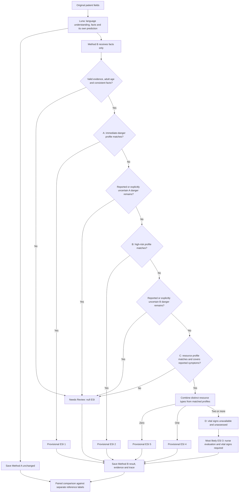

# FirstLook prototype rules and paired testing

Updated 28 October 2026. Active mode: `research_prototype`. Rule version `research-esi-patient-report-2.1.0` (92 profiles). Version 2.1.0 was written after the first TEST run; see [Version 2.1.0](#version-210-changes-after-the-first-test-run).

## What is implemented

Method B has **one deterministic engine with input checks and A/B/C/D stages**. Its 70 profiles comprise nine A profiles, forty-seven B profiles and fourteen C profiles. The original 32 were developed on the DEV split; the 38 added in version 2.0.0 were written from handbook categories, each with a quoted handbook basis, without reference to TEST inputs. It accepts the existing 15 patient fields through evidence-linked, language-independent concepts. It has no per-language phrase lists, case-ID lookups, reference-label lookup, second LLM decision or fallback ESI 3.

The result statuses are `classified` or `needs_review`; execution errors are recorded separately. There is no `unreviewed` result status. The 70-profile version 2.0.0 catalog has a verbal review record (Abigail Rose Gayatin-Sabandal, PHRN, USRN, 27 October 2026, `FIRSTLOOK-REPORTED-VERBAL-2026-10-27-01`) in `config/esi.php` under `research_approval`. Version 2.1.0 (92 profiles) has a verbal approval reported by the team on 28 October 2026 (`FIRSTLOOK-REPORTED-VERBAL-2026-10-28-01`); the written review form is not yet signed. The 2.0.0 record is kept under `research_approval_history`. A record applies only while its `rule_version` matches the catalog; any rule, signal, concept or engine change makes `study:check` block until a new review is recorded. The review covers the rule specification, not measured clinical accuracy. The old 18 approved definitions, their hashes and earlier database results remain intact.

## Method A and Method B

1. Send the 15 patient fields to the configured Luna model. Case IDs, language-condition labels, DEV/TEST labels and reference ESI answers remain local.
2. Luna returns its own provisional prediction, verbatim extracted facts and normalized symptom concepts with original-language evidence. Both methods receive the same research criteria in the study design; Method A interprets them without executing the PHP engine.
3. Save Method A exactly as received after schema/evidence validation. A valid Needs Review response is not retried to obtain a preferred prediction.
4. Pass only the accepted extracted facts and normalized concepts to Method B. Method A's priority and explanation never enter the engine.
5. Evaluate the fixed rules and save Method B independently, with matched rule IDs, observed states, evidence, sources, resource hypotheses, unassessed signs and exact version.
6. Link both outputs to an admin-visible patient stub and history. A shared LLM failure means Method B could not run; distinguish that from a failure inside the rule engine.

## Complete decision flow

[Download the Mermaid diagram source](research-rule-flowchart.mmd).



**Unmentioned is not negative.** Unlike the previous mode, this prototype permits a complete positive profile to produce a conditional prediction when other danger signs were not mentioned. Those signs remain `missing` or `unknown` in `unassessed_danger_signs`. An actual reported danger signal that lacks a complete profile still stops progression. Explicit uncertainty with evidence also stops progression. This is an experimental assumption, not proof that earlier clinical risks were excluded.

Every numerical prediction is provisional. No normal vital signs are invented. A/B/C uncertainty does not default to 3. The ESI 3 display is not a calibrated probability or a statement that waiting is safe.

## All profiles

The machine-readable conditions and source sections are exported in [research-rule-catalog.json](research-rule-catalog.json). Within a profile, all mandatory conditions and one condition from each alternative group must match. The table below is a readable index; the export is the exact specification.

| Stage | Rule IDs | Profile family |
|---|---|---|
| A | `RP-A-APNEA`, `RP-A-AIRWAY` | Reported absence of breathing; unresponsiveness with airway/breathing danger |
| A | `RP-A-BLEEDING`, `RP-A-CONVULSIONS` | Uncontrolled bleeding with deterioration; ongoing convulsions with unresponsiveness or blue colour |
| B | `RP-B-CHEST`, `RP-B-TEARING-PAIN` | Concerning chest cluster; abrupt tearing torso pain |
| B | `RP-B-NEUROLOGICAL`, `RP-B-BACK-NEUROLOGICAL`, `RP-B-HEADACHE` | New motor/speech symptoms; back pain with neurological changes; sudden worst headache |
| B | `RP-B-ALLERGY`, `RP-B-EYE`, `RP-B-LEG-BREATHING` | Exposure with throat/breathing symptoms; new painful visual disturbance; leg swelling with breathlessness |
| B | `RP-B-CHEMOTHERAPY`, `RP-B-CONFUSION`, `RP-B-SELF-HARM` | Fever during chemotherapy; new confusion; current suicidal intent |
| B | `RP-B-OVERDOSE`, `RP-B-NEEDLESTICK`, `RP-B-SEIZURE`, `RP-B-CANCER-PAIN` | Current ingestion, recent exposure/seizure, contextual cancer-related pain |
| C | `RP-C-ABDOMEN`, `RP-C-FEBRILE-COUGH`, `RP-C-LEG-SWELLING` | Fixed laboratory-plus-imaging hypotheses |
| C | `RP-C-VOMITING`, `RP-C-DIARRHEA` | Fixed laboratory-plus-IV-hydration hypotheses |
| C | `RP-C-LIMB-INJURY`, `RP-C-URINARY` | One imaging or laboratory resource group |
| C | `RP-C-CUT`, `RP-C-EAR-OBJECT` | One simple-procedure hypothesis |
| C | `RP-C-REFILL`, `RP-C-LOCAL-SKIN`, `RP-C-IMPROVING-URI`, `RP-C-NASAL` | Zero-counted-resource hypotheses with supporting context |

### Profiles added in version 2.0.0

Each added profile stores a `handbook_basis` quotation and cites the edition, chapter and printed page. "v4" is the 2012 AHRQ handbook; "v5" is the 2023 ENA fifth edition. Where the editions differ, the rules in "How conflicts are resolved" below apply.

| Stage | Rule IDs | Handbook basis (printed pages) |
|---|---|---|
| A | `RP-A-UNRESPONSIVE`, `RP-A-ACTIVE-SEIZURE` | Unresponsiveness and active seizure require lifesaving intervention (v4 p. 10; v5 p. 9) |
| A | `RP-A-CHEST-SHOCK`, `RP-A-ANAPHYLAXIS`, `RP-A-DROOLING` | Chest pain with paleness and sweating; allergic reaction with collapse; drooling or inability to swallow saliva (v4 pp. 10–11, 19; v5 p. 9) |
| B | `RP-B-CHEST-ISCHEMIA` | Chest discomfort "with or without accompanying symptoms" (v4 p. 19; v5 p. 12); excluded when a cough is reported |
| B | `RP-B-STROKE-SIGNS`, `RP-B-MENTAL-STATUS`, `RP-B-HEADACHE-RED-FLAGS` | Stroke signs; new confusion, lethargy or disorientation; headache with neck, fever, vomiting, back-pain, mental-status or stroke features (v4 pp. 12, 20, 26–27; v5 p. 12) |
| B | `RP-B-SUICIDAL-THOUGHTS`, `RP-B-DANGER-TO-OTHERS`, `RP-B-SEVERE-DISTRESS-EVENT` | Suicidal, homicidal or psychotic presentations; sexual assault, domestic violence, prenatal loss (v4 pp. 20, 24, 27; v5 pp. 12, 15) |
| B | `RP-B-RENAL-COLIC`, `RP-B-URINARY-RETENTION`, `RP-B-SICKLE-CELL-PAIN`, `RP-B-BURN-BLISTERING` | Pain that cannot be managed at triage (v4 pp. 19, 26–27; v5 pp. 12, 14) |
| B | `RP-B-UROSEPSIS-SIGNS`, `RP-B-OLDER-ADULT-ABDOMEN` | Urinary symptoms with back pain or chills; severe abdominal pain in older adults (v4 pp. 18, 23; v5 pp. 11, 14) |
| B | `RP-B-PENETRATING-INJURY`, `RP-B-HIGH-RISK-MECHANISM`, `RP-B-HEAD-INJURY-RED-FLAGS` | Stab and gunshot wounds; falls of 6 m or more, ejection, extrication, pedestrian struck; head injury with loss of consciousness, amnesia, vomiting or confusion (v4 pp. 21–22, 25; v5 p. 15) |
| B | `RP-B-ACUTE-LIMB-ISCHEMIA`, `RP-B-LIMB-NEUROVASCULAR`, `RP-B-AMPUTATION` | Cold or numb injured limbs and amputations (v4 pp. 19, 21, 23; v5 p. 15) |
| B | `RP-B-PREGNANCY-SYMPTOMS`, `RP-B-FEMALE-LOWER-QUADRANT`, `RP-B-POSTPARTUM-BLEEDING`, `RP-B-TESTICULAR` | Pregnancy with chest pain, breathlessness, one-sided lower abdominal pain or headache; severe one-sided lower abdominal pain in a female patient; postpartum heavy bleeding; testicular pain (v4 pp. 20–21, 24; v5 pp. 12, 14) |
| B | `RP-B-SUDDEN-VISION-LOSS`, `RP-B-CHEMICAL-EYE`, `RP-B-EYE-TRAUMA` | Sudden vision loss, chemical splash and significant eye trauma (v4 pp. 21, 23, 31) |
| B | `RP-B-NOSEBLEED-BLEEDING-RISK`, `RP-B-POISONING` | Nosebleed with anticoagulant or bleeding disorder; toxic ingestion (v4 pp. 19, 22; v5 pp. 13, 15) |
| B | `RP-B-DIABETIC-VOMITING`, `RP-B-DIALYSIS`, `RP-B-TRANSPLANT-FEVER`, `RP-B-VALVE-FEVER` | Medical-history high-risk situations from Table 3-1 and the text (v4 pp. 19–20, 22–23; v5 pp. 12, 15) |
| C | `RP-C-EYE-PARTICLE` | Dust in the eye: irrigation is one resource, ESI 4 (v4 p. 31) |

Two features were added to the rule format. A `none` list prevents a profile from matching when a listed concept is reported, so a handbook exception can be encoded (for example, chest pain with a cough). A `min_age` requires an explicit age. The only age threshold, 65 years, follows v5 p. 11, which names people aged 65 and older as at increased risk of under-triage; the handbooks themselves say "elderly" without a number for these rules.

### How conflicts are resolved

The two handbook editions sometimes assign different levels, and the engine's own mechanics can contradict the handbook text. These rules decide every such case:

1. **Edition conflict for the same adult presentation → follow v4.** The thesis cites ESI v4 [14] and the reference labels were produced against it. The v5 difference is recorded in the rule's `handbook_basis`.
2. **v4 silent for adults, v5 assigns a level → use v5.**
3. **Engine mechanics contradict both editions → follow the handbook.**
4. **A rule is stricter than both editions without a stated reason → relax it to the handbook wording.**
5. **Overlapping rules are kept.** A narrower original rule (for example `RP-A-AIRWAY` inside `RP-A-UNRESPONSIVE`) gives the same level as the broader one and preserves DEV traceability.

| Conflict | Decision | Basis |
|---|---|---|
| Reported seizure in a person with known epilepsy who is alert: v4 ESI 2 for every reported seizure (p. 20); v5 triage by physiology and resources (p. 12) | Keep `RP-B-SEIZURE` at ESI 2 | Rule 1 |
| Allergic exposure with throat tightening: v4 ESI 2 (peanut example, p. 18); v5 lists "anaphylaxis" as ESI 1 (p. 9) | Keep `RP-B-ALLERGY` at ESI 2; collapse or blue colour gives ESI 1 (`RP-A-ANAPHYLAXIS`) | Rule 1; both editions agree on shock |
| Drooling or inability to swallow saliva: v4 ESI 1 (p. 19); v5 ESI 2 (p. 13) | Added `RP-A-DROOLING` at ESI 1 | Rule 1 |
| Pregnancy with generalized abdominal cramping: v4 not ESI 2 (p. 20); v5 any abdominal pain ESI 2 (p. 14) | `RP-B-PREGNANCY-SYMPTOMS` matches only one-sided lower abdominal pain, plus v5's chest pain, breathlessness and headache | Rules 1 and 2 |
| Active seizure in an adult: v4 lists it only for children (Table 6-2, p. 46); v5 ESI 1 (p. 9) | Keep `RP-A-ACTIVE-SEIZURE` at ESI 1 | Rule 2 |
| Severe pain with a limb injury: the engine treated reported severe pain as a blocking danger sign, but both editions let orthopedic pain wait for resource prediction (v4 pp. 12, 26; v5 p. 12) | Severe pain no longer blocks when a limb injury is reported; the injury resource profile decides | Rule 3 |
| Needle stick: the rule required "just now", which neither edition states (v4 p. 12; v5 p. 12) | `RP-B-NEEDLESTICK` no longer requires timing | Rule 4 |
| Severe one-sided lower abdominal pain in a female patient: v4 Table 3-1 ESI 2 (p. 24); v5 "should be evaluated" (p. 14) | Added `RP-B-FEMALE-LOWER-QUADRANT` for explicitly severe pain only; non-severe pain stays with resource profiles | v4 example; a pregnancy denial is not nurse confirmation |
| Chest pain with cough: `RP-B-CHEST-ISCHEMIA` excludes cough, but `RP-B-CHEST` still matches chest pain with cough plus arm pain, sweating, breathlessness or nausea | Kept as is | Not a conflict: v4's exception is chest pain with cough and "no other cardiovascular risk factors" (p. 19) |

**Removed after the 22 October DEV run:** `RP-B-OLDER-ADULT-UTI` (v5 p. 14: urinary symptoms in an elderly patient → ESI 2). It was the only added rule that changed a DEV outcome, and it disagreed with the reviewed reference label in all five versions of that case. v4 does not support it, so under rule 1 the v4-based labels take precedence. The decision was made on DEV, before any TEST prediction.

**Method A prompt v6.** The DEV run showed Method A abstaining for reasons the rule engine does not apply (for example, treating an unrelated symptom as blocking an ESI 2 profile). Prompt v6 states the engine's decision order literally and includes the engine's exact checks (`ResearchEsiRuleCatalog::decisionChecks()`): danger-signal lists, the severe-pain exemption, the decision-point-C coverage lists and the contradiction pairs. The engine reads the same constants, so both methods use identical criteria.

**Coverage consistency fixes (22 October, DEV).** Two decision-point-C checks treated co-reported concepts inconsistently: a cut on a hand or limb is also a `limb_injury`, which `RP-C-CUT` did not account for, and a profile that accounts for a general symptom did not account for its specific forms (dizziness → lightheadedness on standing; abdominal pain → one-sided lower abdominal pain; vomiting → repeated vomiting). `RP-C-CUT` now accounts for `limb_injury` and `limb_pain` (v4 p. 30: a simple leg laceration needs one resource), and `SPECIFIC_FORMS` extends every profile's coverage to the specific forms. These were found on DEV and are general rules, not case lookups.

Two original citations were also corrected: `RP-A-CONVULSIONS` now cites v4 Table 6-2 (p. 46) and v5 p. 9 instead of a non-existent p. 11 example, and `RP-A-BLEEDING` cites Table 2-1 on p. 9 rather than p. 10.

### Handbook items deliberately not encoded

These remain Needs Review because the handbooks make the decision depend on vital signs, measurements or nurse judgment that patient reports cannot supply:

- **Shortness of breath or respiratory distress alone.** Mild-to-moderate distress "should be further evaluated for respiratory rate and pulse oximetry" (v4 p. 21; v5 p. 13), and severe distress can be ESI 1 or 2.
- **Severe pain rated 7/10 or higher alone.** "Not all patients with a pain score greater than 7 should be triaged as ESI level 2" (v4 p. 26; v5 p. 12). Only the systemic pain causes the handbooks name are encoded.
- **Vomiting blood or blood in the stool.** Evaluated "in the context of vital signs" (v4 p. 19).
- **Fainting or near-fainting.** Listed as a complaint to assess carefully, not an automatic level (v4 p. 20).
- **Possible hip, femur or pelvic fractures and dislocations.** "Should be carefully evaluated and vital signs considered" (v4 p. 21; v5 p. 15).
- **Hypertensive crisis, hyperkalemia, blood-sugar extremes, abnormal ECG and pregnancy blood-pressure thresholds.** Each needs a measurement.
- **Isolated sore throat.** ESI 4 or 5 depending on whether the institution performs throat cultures (v4 p. 32; v5 p. 20).

## Verified sources and their actual role

Links were checked on 21 October 2026. Access level is disclosed below; publisher access may vary.

1. **Gilboy, Tanabe, Travers and Rosenau (2011), ESI Version 4 Implementation Handbook, 2012 Edition, AHRQ 12-0014.** [Official government PDF](https://www.govinfo.gov/content/pkg/GOVPUB-HE20_6500-PURL-gpo23161/pdf/GOVPUB-HE20_6500-PURL-gpo23161.pdf). Full handbook inspected. Chapters 2–5 supply the decision sequence, resource framework and vital-sign step. The catalog cites printed pages for each profile. Broader patient-report conditions and fixed resource hypotheses are our adaptations; the handbook does not validate them.

1a. **Emergency Nurses Association (2023), Emergency Severity Index Handbook, Fifth Edition (ESI v5).** [EMSC Innovation and Improvement Center PDF](https://media.emscimprovement.center/documents/Emergency_Severity_Index_Handbook.pdf). Full text (36 pages) inspected on 22 October 2026. It is the current edition: the algorithm is "fundamentally unchanged," but decision point B is reorganised and several high-risk examples are broader. Its FAQ states that an ESI level "requires a history of present illness, brief focused assessment, and vital signs" and that assigning one without an assessment "may result in significant undertriage" (p. 27). That statement is a direct limitation of any patient-report-only prediction, including both methods in this study.

2. **Dehghani Soufi et al. (2018), “Decision support system for triage management: A hybrid approach using rule-based reasoning and fuzzy logic,” International Journal of Medical Informatics 114:35–44. DOI: 10.1016/j.ijmedinf.2018.03.008.** [PubMed abstract](https://pubmed.ncbi.nlm.nih.gov/29673601/). Abstract inspected. It supports expressing ESI decisions as explicit rules and evaluating a hybrid system. Its fuzzy component used vital signs, so it does not justify treating absent measurements as normal or establish our patient-only rules.

3. **Elias et al. (2015), “A Web-Based Tool for Patient Triage in Emergency Department Settings: Validation Using the Emergency Severity Index,” JMIR Medical Informatics 3(2):e23. DOI: 10.2196/medinform.3508.** [Full article](https://medinform.jmir.org/2015/2/e23/). Full text inspected. It supports comparing software triage outputs with reference vignette answers. Its inputs included available vital signs and examination findings. Its results are not evidence that our symptom-only implementation has the same performance.

4. **Gaber et al. (2025), “Evaluating large language model workflows in clinical decision support for triage and referral and diagnosis,” npj Digital Medicine 8:263. DOI: 10.1038/s41746-025-01684-1.** [Publisher article](https://www.nature.com/articles/s41746-025-01684-1), [PMC copy](https://pmc.ncbi.nlm.nih.gov/articles/PMC12064692/). Indexed full-text Methods inspected; direct page retrieval encountered access challenges. The study distinguished general-user symptom/basic-information inputs from clinical-user inputs augmented with initial vital signs. This supports studying restricted-input predictions, not claiming complete clinical ESI or transferring its model performance to Luna.

5. **Sharma et al. (2026), “ED-triage-agent: a multi-agent framework for human-in-the-loop emergency triage,” International Journal of Medical Informatics 221:106652. DOI: 10.1016/j.ijmedinf.2026.106652.** [PubMed abstract](https://pubmed.ncbi.nlm.nih.gov/42612553/). Abstract inspected; online publication 18 August 2026, issue date 15 November 2026. It distinguishes symptom-only provisional ESI-scaled signals from later recommendations incorporating vital signs. This is the closest support for the two-stage concept. It uses a different multi-agent/RAG architecture and does not validate our deterministic profiles; prospective clinical validation remains a limitation in its conclusion.

## Version 2.1.0 changes after the first TEST run

The frozen TEST run of version 2.0.0 (`firstlook-final-2026-10-27`, 1,800 records) left about half of all inputs as Needs review, mostly at decision point C. Version 2.1.0 was written **after inspecting those TEST outputs**, so TEST is no longer unseen for this version. Any result produced with it must say so. The 2.0.0 run and its scored results are kept unchanged in `storage/app/private/studies/firstlook-final-2026-10-27/`.

Changes, by type:

- **New concepts (18):** `choking`, `bruising`, `skin_dryness`, `skin_redness`, `skin_lump`, `muscle_stiffness`, `limited_movement`, `localized_warmth`, `nasal_congestion`, `bloating`, `dry_mouth`, `vaginal_spotting`, `blood_in_urine`, `palpitations`, `animal_bite`, `torso_injury`, `minor_wound`, `deep_wound`. `scratchy_throat` now includes a sore throat. Vocabulary version `patient-concepts-v4-research`; symptom prompt `normalization-v5-research`; Method A prompt `screening-study-v9-research`.
- **Minor accompanying findings no longer block C.** Bruising, dryness, local redness, stiffness, warmth, congestion, bloating, dry mouth and tenderness are not in `c_symptoms_needing_coverage`. They cannot produce a level on their own.
- **New A profiles (2):** `RP-A-RESPIRATORY-DISTRESS`, `RP-A-CHOKING`.
- **New B profiles (3):** `RP-B-SEVERE-PAIN-DISTRESS` (explicit severe pain or distress outside a limb injury), `RP-B-FAINTING`, `RP-B-GI-BLEEDING`. `RP-B-ALLERGY` also accepts a widespread rash in its first group.
- **New C profiles (17):** `RP-C-GI-FLUID-LOSS`, `RP-C-URINARY-FEVER`, `RP-C-BLOOD-IN-URINE`, `RP-C-JOINT-SWELLING`, `RP-C-SKIN-INFECTION`, `RP-C-DEEP-WOUND`, `RP-C-WOUND-REPAIR`, `RP-C-FACE-CUT`, `RP-C-TORSO-INJURY`, `RP-C-SORE-THROAT-FEVER`, `RP-C-MINOR-CUT`, `RP-C-BRUISE`, `RP-C-SKIN-LUMP`, `RP-C-MINOR-BURN`, `RP-C-ANIMAL-BITE`, `RP-C-SORE-THROAT`, `RP-C-BACK-STRAIN`.
- **Loosened C profiles (3):** `RP-C-LOCAL-SKIN` and `RP-C-NASAL` no longer require explicit denials or a report of feeling well, only no reported fever (and, for skin, no widespread rash). `RP-C-LIMB-INJURY` also accepts limited movement or bruising.
- **Engine:** chest discomfort no longer blocks decision B when both cough and fever are reported (v4 p. 19 and Table 3-1). A head injury blocks C only when no matched profile accounts for it.

Most new profiles are researcher hypotheses, not handbook examples; three cite ESI v4 Table 4-1 (simple wound care and tetanus immunization are not resources). On the saved 2.0.0 TEST facts, without new LLM output, the 2.1.0 engine reduces Method B Needs review from 905 to 645 of 1,775 evaluable records, with no undertriage. That replay is an estimate only; the new concepts take effect only in a fresh run.

## Methodology change to disclose

The supplied paper describes reviewed mappings and explicit earlier-decision exclusions. The user's later instruction authorizes a research prototype without those approval gates. This implementation therefore changes that part of the protocol. Before presenting a frozen comparison as the final thesis experiment, describe the positive-danger screening, fixed resource hypotheses, unassessed negatives, and prototype scope accurately. The original paper has not been silently overwritten in this implementation task.

## Reproducible testing

```bash
docker compose up -d app node
docker compose exec -T app php artisan study:check --json --no-interaction
docker compose exec -T app vendor/bin/phpunit
docker compose exec -T node npm run build
```

For paired DEV testing, use `study:dev-baseline ... --paired-pilot --run-id=<new-id>`. Without `--paired-pilot`, the historical DEV command remains Method A only. A saved run cannot resume under changed inputs, prompts or configuration. Do not delete failed attempts or repeat a valid Needs Review response to improve the score.

For the final experiment, the existing `study:freeze`, `study:run --run=1`, `--run=2`, `--run=3`, and `study:score` workflow remains paired. Freeze after development; keep the TEST reference key separate. Report accuracy/F1/undertriage/overtriage on the same common numerical pairs, alongside coverage, abstentions, technical failures and completion-adjusted accuracy over all scheduled inputs. TEST has not been submitted during this implementation task.

See [the fresh DEV pilot results](research-prototype-dev-results.md) for actual measured outcomes; software test fixtures are not counted as dataset findings.
